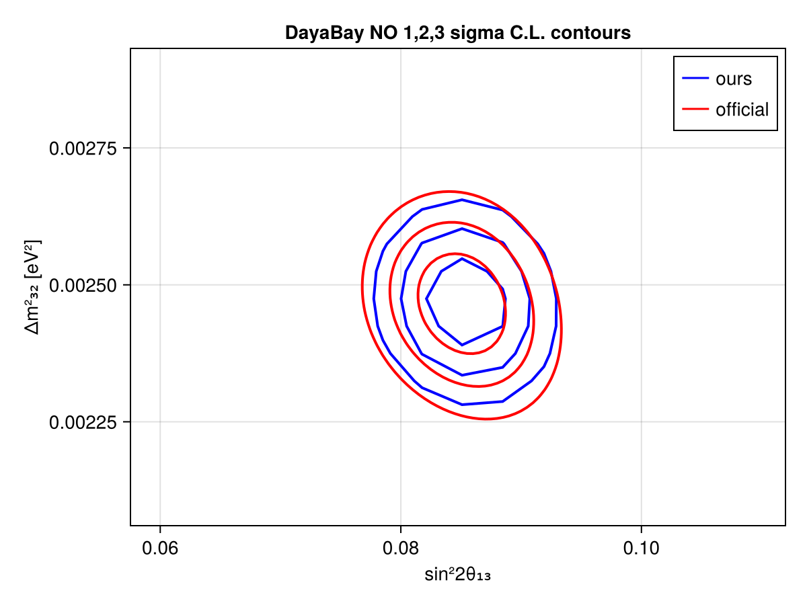
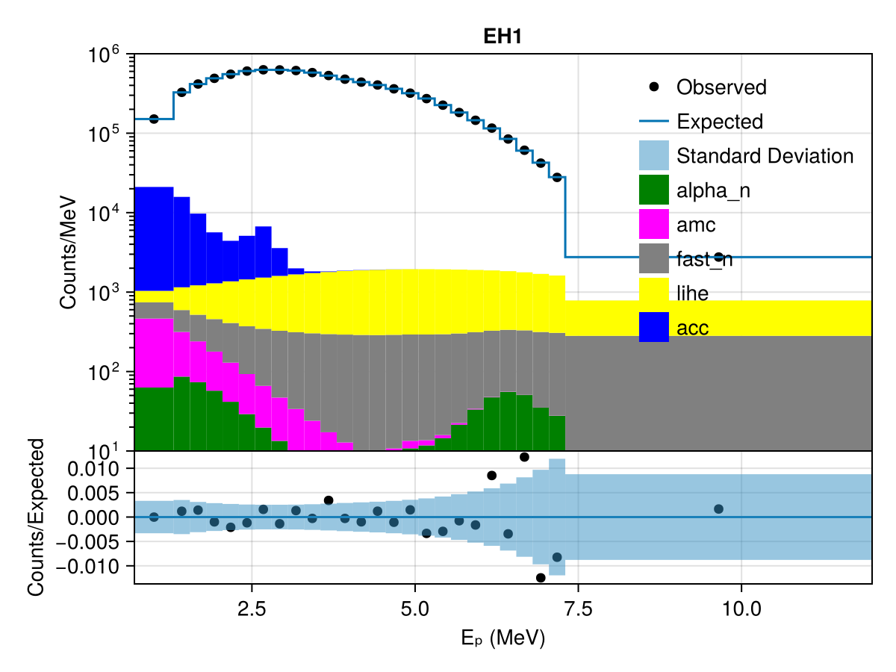
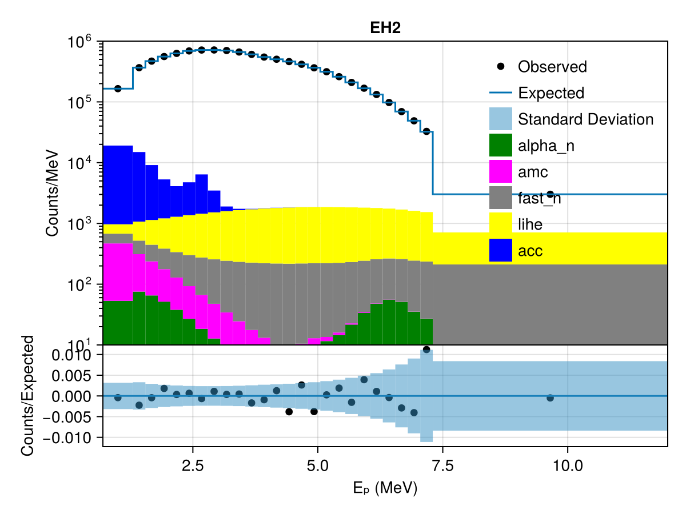
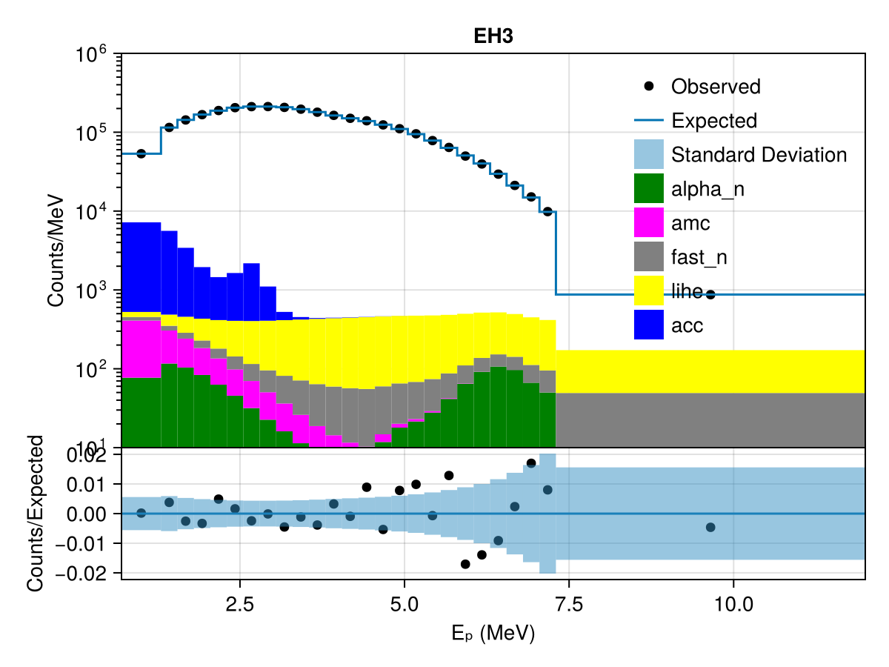

# DayaBay
 ## Resources
Data from https://zenodo.org/records/17587229

## General information
In contrast to `../daya_bay_3158days/dayabay.jl, this moduleforward models from reactor spectra to the data space.
## Test output plots
These plots are generated using 25 pull parameters on the reactor spectrum.

Plots for individual EHs per 6/8/7 AD period in `test_output`
## Meta Information
- **task**: profile
- **date**: 2026-11-11 08:41:19
- **vars_to_scan**: OrderedDict{Any, Any}(:θ₁₃ => 11, :Δm²₃₁ => 11)
- **username**: kuhlmann
- **repo_clean**: false
- **exec_time**: 6.869138956069946
- **repo**: /home/iwsatlas1/kuhlmann/DEMOS/neutrinos/osc/Newtrinos.jl
- **hostname**: cslg-03
- **params**: (acc_scale = [1.0, 1.0, 1.0, 1.0, 1.0, 1.0, 1.0, 1.0, 1.0, 1.0, 1.0, 1.0, 1.0, 1.0, 1.0, 1.0, 1.0, 1.0, 1.0, 1.0, 1.0], alpha_n_rate = [0.09, 0.07, 0.05, 0.05, 0.04, 0.04, 0.08, 0.06, 0.04, 0.06, 0.04, 0.04, 0.03, 0.04, 0.05, 0.03, 0.06, 0.03, 0.03, 0.03, 0.03], amc_unc_scale = 0.0, eff_eres_AD11 = [1.0, 1.0], eff_eres_AD12 = [1.0, 1.0], eff_eres_AD21 = [1.0, 1.0], eff_eres_AD22 = [1.0, 1.0], eff_eres_AD31 = [1.0, 1.0], eff_eres_AD32 = [1.0, 1.0], eff_eres_AD33 = [1.0, 1.0], eff_eres_AD34 = [1.0, 1.0], energy_per_fission = [202.36, 205.99, 211.12, 214.26], eres_a = 0.016, eres_b = 0.081, eres_c = 0.026, fast_n_unc_scale = [0.0, 0.0, 0.0, 0.0, 0.0, 0.0, 0.0, 0.0, 0.0], fission_fractions_scale_R1 = [1.0, 1.0, 1.0, 1.0], fission_fractions_scale_R2 = [1.0, 1.0, 1.0, 1.0], fission_fractions_scale_R3 = [1.0, 1.0, 1.0, 1.0], fission_fractions_scale_R4 = [1.0, 1.0, 1.0, 1.0], fission_fractions_scale_R5 = [1.0, 1.0, 1.0, 1.0], fission_fractions_scale_R6 = [1.0, 1.0, 1.0, 1.0], iav_offdiag_scale = [1.0, 1.0, 1.0, 1.0, 1.0, 1.0, 1.0, 1.0], lihe_unc_scale = [0.0, 0.0, 0.0, 0.0, 0.0, 0.0, 0.0, 0.0, 0.0], lsnl_pull = [0.0, 0.0, 0.0, 0.0], neq_scale_R1 = [1.0, 1.0, 1.0, 1.0], neq_scale_R2 = [1.0, 1.0, 1.0, 1.0], neq_scale_R3 = [1.0, 1.0, 1.0, 1.0], neq_scale_R4 = [1.0, 1.0, 1.0, 1.0], neq_scale_R5 = [1.0, 1.0, 1.0, 1.0], neq_scale_R6 = [1.0, 1.0, 1.0, 1.0], reactor_thermal_power_scale = [1.0, 1.0, 1.0, 1.0, 1.0, 1.0], snf_scale = [1.0, 1.0, 1.0, 1.0, 1.0, 1.0], spectrum_pulls = [0.0, 0.0, 0.0, 0.0, 0.0, 0.0, 0.0, 0.0, 0.0, 0.0, 0.0, 0.0, 0.0, 0.0, 0.0, 0.0, 0.0, 0.0, 0.0, 0.0, 0.0, 0.0, 0.0, 0.0, 0.0], Δm²₂₁ = 7.53e-5, Δm²₃₁ = 0.0024752999999999997, δCP = 1.0, θ₁₂ = 0.5872523687443223, θ₁₃ = 0.1454258194533693, θ₂₃ = 0.8556288707523761)
- **starts**: [NamedTuple()]
- **package_version**: 0.1.1
- **cache_dir**: test_cache
- **priors**: (acc_scale = DiagNormal(
dim: 21
μ: [1.0, 1.0, 1.0, 1.0, 1.0, 1.0, 1.0, 1.0, 1.0, 1.0, 1.0, 1.0, 1.0, 1.0, 1.0, 1.0, 1.0, 1.0, 1.0, 1.0, 1.0]
Σ: [0.0001 0.0 0.0 0.0 0.0 0.0 0.0 0.0 0.0 0.0 0.0 0.0 0.0 0.0 0.0 0.0 0.0 0.0 0.0 0.0 0.0; 0.0 0.0001 0.0 0.0 0.0 0.0 0.0 0.0 0.0 0.0 0.0 0.0 0.0 0.0 0.0 0.0 0.0 0.0 0.0 0.0 0.0; 0.0 0.0 0.0001 0.0 0.0 0.0 0.0 0.0 0.0 0.0 0.0 0.0 0.0 0.0 0.0 0.0 0.0 0.0 0.0 0.0 0.0; 0.0 0.0 0.0 0.0001 0.0 0.0 0.0 0.0 0.0 0.0 0.0 0.0 0.0 0.0 0.0 0.0 0.0 0.0 0.0 0.0 0.0; 0.0 0.0 0.0 0.0 0.0001 0.0 0.0 0.0 0.0 0.0 0.0 0.0 0.0 0.0 0.0 0.0 0.0 0.0 0.0 0.0 0.0; 0.0 0.0 0.0 0.0 0.0 0.0001 0.0 0.0 0.0 0.0 0.0 0.0 0.0 0.0 0.0 0.0 0.0 0.0 0.0 0.0 0.0; 0.0 0.0 0.0 0.0 0.0 0.0 0.0001 0.0 0.0 0.0 0.0 0.0 0.0 0.0 0.0 0.0 0.0 0.0 0.0 0.0 0.0; 0.0 0.0 0.0 0.0 0.0 0.0 0.0 0.0001 0.0 0.0 0.0 0.0 0.0 0.0 0.0 0.0 0.0 0.0 0.0 0.0 0.0; 0.0 0.0 0.0 0.0 0.0 0.0 0.0 0.0 0.0001 0.0 0.0 0.0 0.0 0.0 0.0 0.0 0.0 0.0 0.0 0.0 0.0; 0.0 0.0 0.0 0.0 0.0 0.0 0.0 0.0 0.0 0.0001 0.0 0.0 0.0 0.0 0.0 0.0 0.0 0.0 0.0 0.0 0.0; 0.0 0.0 0.0 0.0 0.0 0.0 0.0 0.0 0.0 0.0 0.0001 0.0 0.0 0.0 0.0 0.0 0.0 0.0 0.0 0.0 0.0; 0.0 0.0 0.0 0.0 0.0 0.0 0.0 0.0 0.0 0.0 0.0 0.0001 0.0 0.0 0.0 0.0 0.0 0.0 0.0 0.0 0.0; 0.0 0.0 0.0 0.0 0.0 0.0 0.0 0.0 0.0 0.0 0.0 0.0 0.0001 0.0 0.0 0.0 0.0 0.0 0.0 0.0 0.0; 0.0 0.0 0.0 0.0 0.0 0.0 0.0 0.0 0.0 0.0 0.0 0.0 0.0 0.0001 0.0 0.0 0.0 0.0 0.0 0.0 0.0; 0.0 0.0 0.0 0.0 0.0 0.0 0.0 0.0 0.0 0.0 0.0 0.0 0.0 0.0 0.0001 0.0 0.0 0.0 0.0 0.0 0.0; 0.0 0.0 0.0 0.0 0.0 0.0 0.0 0.0 0.0 0.0 0.0 0.0 0.0 0.0 0.0 0.0001 0.0 0.0 0.0 0.0 0.0; 0.0 0.0 0.0 0.0 0.0 0.0 0.0 0.0 0.0 0.0 0.0 0.0 0.0 0.0 0.0 0.0 0.0001 0.0 0.0 0.0 0.0; 0.0 0.0 0.0 0.0 0.0 0.0 0.0 0.0 0.0 0.0 0.0 0.0 0.0 0.0 0.0 0.0 0.0 0.0001 0.0 0.0 0.0; 0.0 0.0 0.0 0.0 0.0 0.0 0.0 0.0 0.0 0.0 0.0 0.0 0.0 0.0 0.0 0.0 0.0 0.0 0.0001 0.0 0.0; 0.0 0.0 0.0 0.0 0.0 0.0 0.0 0.0 0.0 0.0 0.0 0.0 0.0 0.0 0.0 0.0 0.0 0.0 0.0 0.0001 0.0; 0.0 0.0 0.0 0.0 0.0 0.0 0.0 0.0 0.0 0.0 0.0 0.0 0.0 0.0 0.0 0.0 0.0 0.0 0.0 0.0 0.0001]
)
, alpha_n_rate = DiagNormal(
dim: 21
μ: [0.09, 0.07, 0.05, 0.05, 0.04, 0.04, 0.08, 0.06, 0.04, 0.06, 0.04, 0.04, 0.03, 0.04, 0.05, 0.03, 0.06, 0.03, 0.03, 0.03, 0.03]
Σ: [0.002025 0.0 0.0 0.0 0.0 0.0 0.0 0.0 0.0 0.0 0.0 0.0 0.0 0.0 0.0 0.0 0.0 0.0 0.0 0.0 0.0; 0.0 0.0012250000000000002 0.0 0.0 0.0 0.0 0.0 0.0 0.0 0.0 0.0 0.0 0.0 0.0 0.0 0.0 0.0 0.0 0.0 0.0 0.0; 0.0 0.0 0.0006250000000000001 0.0 0.0 0.0 0.0 0.0 0.0 0.0 0.0 0.0 0.0 0.0 0.0 0.0 0.0 0.0 0.0 0.0 0.0; 0.0 0.0 0.0 0.0006250000000000001 0.0 0.0 0.0 0.0 0.0 0.0 0.0 0.0 0.0 0.0 0.0 0.0 0.0 0.0 0.0 0.0 0.0; 0.0 0.0 0.0 0.0 0.0004 0.0 0.0 0.0 0.0 0.0 0.0 0.0 0.0 0.0 0.0 0.0 0.0 0.0 0.0 0.0 0.0; 0.0 0.0 0.0 0.0 0.0 0.0004 0.0 0.0 0.0 0.0 0.0 0.0 0.0 0.0 0.0 0.0 0.0 0.0 0.0 0.0 0.0; 0.0 0.0 0.0 0.0 0.0 0.0 0.0016 0.0 0.0 0.0 0.0 0.0 0.0 0.0 0.0 0.0 0.0 0.0 0.0 0.0 0.0; 0.0 0.0 0.0 0.0 0.0 0.0 0.0 0.0009 0.0 0.0 0.0 0.0 0.0 0.0 0.0 0.0 0.0 0.0 0.0 0.0 0.0; 0.0 0.0 0.0 0.0 0.0 0.0 0.0 0.0 0.0004 0.0 0.0 0.0 0.0 0.0 0.0 0.0 0.0 0.0 0.0 0.0 0.0; 0.0 0.0 0.0 0.0 0.0 0.0 0.0 0.0 0.0 0.0009 0.0 0.0 0.0 0.0 0.0 0.0 0.0 0.0 0.0 0.0 0.0; 0.0 0.0 0.0 0.0 0.0 0.0 0.0 0.0 0.0 0.0 0.0004 0.0 0.0 0.0 0.0 0.0 0.0 0.0 0.0 0.0 0.0; 0.0 0.0 0.0 0.0 0.0 0.0 0.0 0.0 0.0 0.0 0.0 0.0004 0.0 0.0 0.0 0.0 0.0 0.0 0.0 0.0 0.0; 0.0 0.0 0.0 0.0 0.0 0.0 0.0 0.0 0.0 0.0 0.0 0.0 0.000225 0.0 0.0 0.0 0.0 0.0 0.0 0.0 0.0; 0.0 0.0 0.0 0.0 0.0 0.0 0.0 0.0 0.0 0.0 0.0 0.0 0.0 0.0004 0.0 0.0 0.0 0.0 0.0 0.0 0.0; 0.0 0.0 0.0 0.0 0.0 0.0 0.0 0.0 0.0 0.0 0.0 0.0 0.0 0.0 0.0006250000000000001 0.0 0.0 0.0 0.0 0.0 0.0; 0.0 0.0 0.0 0.0 0.0 0.0 0.0 0.0 0.0 0.0 0.0 0.0 0.0 0.0 0.0 0.000225 0.0 0.0 0.0 0.0 0.0; 0.0 0.0 0.0 0.0 0.0 0.0 0.0 0.0 0.0 0.0 0.0 0.0 0.0 0.0 0.0 0.0 0.0009 0.0 0.0 0.0 0.0; 0.0 0.0 0.0 0.0 0.0 0.0 0.0 0.0 0.0 0.0 0.0 0.0 0.0 0.0 0.0 0.0 0.0 0.000225 0.0 0.0 0.0; 0.0 0.0 0.0 0.0 0.0 0.0 0.0 0.0 0.0 0.0 0.0 0.0 0.0 0.0 0.0 0.0 0.0 0.0 0.000225 0.0 0.0; 0.0 0.0 0.0 0.0 0.0 0.0 0.0 0.0 0.0 0.0 0.0 0.0 0.0 0.0 0.0 0.0 0.0 0.0 0.0 0.000225 0.0; 0.0 0.0 0.0 0.0 0.0 0.0 0.0 0.0 0.0 0.0 0.0 0.0 0.0 0.0 0.0 0.0 0.0 0.0 0.0 0.0 0.000225]
)
, amc_unc_scale = Normal{Float64}(μ=0.0, σ=1.0), eff_eres_AD11 = FullNormal(
dim: 2
μ: [1.0, 1.0]
Σ: [1.1299999999999998e-6 1.1586858935880767e-6; 1.1586858935880767e-6 4.0e-6]
)
, eff_eres_AD12 = FullNormal(
dim: 2
μ: [1.0, 1.0]
Σ: [1.1299999999999998e-6 1.1586858935880767e-6; 1.1586858935880767e-6 4.0e-6]
)
, eff_eres_AD21 = FullNormal(
dim: 2
μ: [1.0, 1.0]
Σ: [1.1299999999999998e-6 1.1586858935880767e-6; 1.1586858935880767e-6 4.0e-6]
)
, eff_eres_AD22 = FullNormal(
dim: 2
μ: [1.0, 1.0]
Σ: [1.1299999999999998e-6 1.1586858935880767e-6; 1.1586858935880767e-6 4.0e-6]
)
, eff_eres_AD31 = FullNormal(
dim: 2
μ: [1.0, 1.0]
Σ: [1.1299999999999998e-6 1.1586858935880767e-6; 1.1586858935880767e-6 4.0e-6]
)
, eff_eres_AD32 = FullNormal(
dim: 2
μ: [1.0, 1.0]
Σ: [1.1299999999999998e-6 1.1586858935880767e-6; 1.1586858935880767e-6 4.0e-6]
)
, eff_eres_AD33 = FullNormal(
dim: 2
μ: [1.0, 1.0]
Σ: [1.1299999999999998e-6 1.1586858935880767e-6; 1.1586858935880767e-6 4.0e-6]
)
, eff_eres_AD34 = FullNormal(
dim: 2
μ: [1.0, 1.0]
Σ: [1.1299999999999998e-6 1.1586858935880767e-6; 1.1586858935880767e-6 4.0e-6]
)
, energy_per_fission = DiagNormal(
dim: 4
μ: [202.36, 205.99, 211.12, 214.26]
Σ: [0.06760000000000001 0.0 0.0 0.0; 0.0 0.27040000000000003 0.0 0.0; 0.0 0.0 0.11560000000000002 0.0; 0.0 0.0 0.0 0.10890000000000001]
)
, eres_a = Normal{Float64}(μ=0.016, σ=0.0048), eres_b = Normal{Float64}(μ=0.081, σ=0.024300000000000002), eres_c = Normal{Float64}(μ=0.026, σ=0.0078), fast_n_unc_scale = DiagNormal(
dim: 9
μ: [0.0, 0.0, 0.0, 0.0, 0.0, 0.0, 0.0, 0.0, 0.0]
Σ: [1.0 0.0 0.0 0.0 0.0 0.0 0.0 0.0 0.0; 0.0 1.0 0.0 0.0 0.0 0.0 0.0 0.0 0.0; 0.0 0.0 1.0 0.0 0.0 0.0 0.0 0.0 0.0; 0.0 0.0 0.0 1.0 0.0 0.0 0.0 0.0 0.0; 0.0 0.0 0.0 0.0 1.0 0.0 0.0 0.0 0.0; 0.0 0.0 0.0 0.0 0.0 1.0 0.0 0.0 0.0; 0.0 0.0 0.0 0.0 0.0 0.0 1.0 0.0 0.0; 0.0 0.0 0.0 0.0 0.0 0.0 0.0 1.0 0.0; 0.0 0.0 0.0 0.0 0.0 0.0 0.0 0.0 1.0]
)
, fission_fractions_scale_R1 = FullNormal(
dim: 4
μ: [1.0, 1.0, 1.0, 1.0]
Σ: [0.0025 -0.00055 -0.001325 -0.00045; -0.00055 0.0025 0.00045 0.0006500000000000001; -0.001325 0.00045 0.0025 0.001225; -0.00045 0.0006500000000000001 0.001225 0.0025]
)
, fission_fractions_scale_R2 = FullNormal(
dim: 4
μ: [1.0, 1.0, 1.0, 1.0]
Σ: [0.0025 -0.00055 -0.001325 -0.00045; -0.00055 0.0025 0.00045 0.0006500000000000001; -0.001325 0.00045 0.0025 0.001225; -0.00045 0.0006500000000000001 0.001225 0.0025]
)
, fission_fractions_scale_R3 = FullNormal(
dim: 4
μ: [1.0, 1.0, 1.0, 1.0]
Σ: [0.0025 -0.00055 -0.001325 -0.00045; -0.00055 0.0025 0.00045 0.0006500000000000001; -0.001325 0.00045 0.0025 0.001225; -0.00045 0.0006500000000000001 0.001225 0.0025]
)
, fission_fractions_scale_R4 = FullNormal(
dim: 4
μ: [1.0, 1.0, 1.0, 1.0]
Σ: [0.0025 -0.00055 -0.001325 -0.00045; -0.00055 0.0025 0.00045 0.0006500000000000001; -0.001325 0.00045 0.0025 0.001225; -0.00045 0.0006500000000000001 0.001225 0.0025]
)
, fission_fractions_scale_R5 = FullNormal(
dim: 4
μ: [1.0, 1.0, 1.0, 1.0]
Σ: [0.0025 -0.00055 -0.001325 -0.00045; -0.00055 0.0025 0.00045 0.0006500000000000001; -0.001325 0.00045 0.0025 0.001225; -0.00045 0.0006500000000000001 0.001225 0.0025]
)
, fission_fractions_scale_R6 = FullNormal(
dim: 4
μ: [1.0, 1.0, 1.0, 1.0]
Σ: [0.0025 -0.00055 -0.001325 -0.00045; -0.00055 0.0025 0.00045 0.0006500000000000001; -0.001325 0.00045 0.0025 0.001225; -0.00045 0.0006500000000000001 0.001225 0.0025]
)
, iav_offdiag_scale = DiagNormal(
dim: 8
μ: [1.0, 1.0, 1.0, 1.0, 1.0, 1.0, 1.0, 1.0]
Σ: [0.0016 0.0 0.0 0.0 0.0 0.0 0.0 0.0; 0.0 0.0016 0.0 0.0 0.0 0.0 0.0 0.0; 0.0 0.0 0.0016 0.0 0.0 0.0 0.0 0.0; 0.0 0.0 0.0 0.0016 0.0 0.0 0.0 0.0; 0.0 0.0 0.0 0.0 0.0016 0.0 0.0 0.0; 0.0 0.0 0.0 0.0 0.0 0.0016 0.0 0.0; 0.0 0.0 0.0 0.0 0.0 0.0 0.0016 0.0; 0.0 0.0 0.0 0.0 0.0 0.0 0.0 0.0016]
)
, lihe_unc_scale = DiagNormal(
dim: 9
μ: [0.0, 0.0, 0.0, 0.0, 0.0, 0.0, 0.0, 0.0, 0.0]
Σ: [1.0 0.0 0.0 0.0 0.0 0.0 0.0 0.0 0.0; 0.0 1.0 0.0 0.0 0.0 0.0 0.0 0.0 0.0; 0.0 0.0 1.0 0.0 0.0 0.0 0.0 0.0 0.0; 0.0 0.0 0.0 1.0 0.0 0.0 0.0 0.0 0.0; 0.0 0.0 0.0 0.0 1.0 0.0 0.0 0.0 0.0; 0.0 0.0 0.0 0.0 0.0 1.0 0.0 0.0 0.0; 0.0 0.0 0.0 0.0 0.0 0.0 1.0 0.0 0.0; 0.0 0.0 0.0 0.0 0.0 0.0 0.0 1.0 0.0; 0.0 0.0 0.0 0.0 0.0 0.0 0.0 0.0 1.0]
)
, lsnl_pull = DiagNormal(
dim: 4
μ: [0.0, 0.0, 0.0, 0.0]
Σ: [1.0 0.0 0.0 0.0; 0.0 1.0 0.0 0.0; 0.0 0.0 1.0 0.0; 0.0 0.0 0.0 1.0]
)
, neq_scale_R1 = DiagNormal(
dim: 4
μ: [1.0, 1.0, 1.0, 1.0]
Σ: [0.09 0.0 0.0 0.0; 0.0 0.09 0.0 0.0; 0.0 0.0 0.09 0.0; 0.0 0.0 0.0 0.09]
)
, neq_scale_R2 = DiagNormal(
dim: 4
μ: [1.0, 1.0, 1.0, 1.0]
Σ: [0.09 0.0 0.0 0.0; 0.0 0.09 0.0 0.0; 0.0 0.0 0.09 0.0; 0.0 0.0 0.0 0.09]
)
, neq_scale_R3 = DiagNormal(
dim: 4
μ: [1.0, 1.0, 1.0, 1.0]
Σ: [0.09 0.0 0.0 0.0; 0.0 0.09 0.0 0.0; 0.0 0.0 0.09 0.0; 0.0 0.0 0.0 0.09]
)
, neq_scale_R4 = DiagNormal(
dim: 4
μ: [1.0, 1.0, 1.0, 1.0]
Σ: [0.09 0.0 0.0 0.0; 0.0 0.09 0.0 0.0; 0.0 0.0 0.09 0.0; 0.0 0.0 0.0 0.09]
)
, neq_scale_R5 = DiagNormal(
dim: 4
μ: [1.0, 1.0, 1.0, 1.0]
Σ: [0.09 0.0 0.0 0.0; 0.0 0.09 0.0 0.0; 0.0 0.0 0.09 0.0; 0.0 0.0 0.0 0.09]
)
, neq_scale_R6 = DiagNormal(
dim: 4
μ: [1.0, 1.0, 1.0, 1.0]
Σ: [0.09 0.0 0.0 0.0; 0.0 0.09 0.0 0.0; 0.0 0.0 0.09 0.0; 0.0 0.0 0.0 0.09]
)
, reactor_thermal_power_scale = DiagNormal(
dim: 6
μ: [1.0, 1.0, 1.0, 1.0, 1.0, 1.0]
Σ: [2.5e-5 0.0 0.0 0.0 0.0 0.0; 0.0 2.5e-5 0.0 0.0 0.0 0.0; 0.0 0.0 2.5e-5 0.0 0.0 0.0; 0.0 0.0 0.0 2.5e-5 0.0 0.0; 0.0 0.0 0.0 0.0 2.5e-5 0.0; 0.0 0.0 0.0 0.0 0.0 2.5e-5]
)
, snf_scale = DiagNormal(
dim: 6
μ: [1.0, 1.0, 1.0, 1.0, 1.0, 1.0]
Σ: [0.09 0.0 0.0 0.0 0.0 0.0; 0.0 0.09 0.0 0.0 0.0 0.0; 0.0 0.0 0.09 0.0 0.0 0.0; 0.0 0.0 0.0 0.09 0.0 0.0; 0.0 0.0 0.0 0.0 0.09 0.0; 0.0 0.0 0.0 0.0 0.0 0.09]
)
, spectrum_pulls = Uniform{Float64}[Uniform{Float64}(a=-1.0, b=1.0), Uniform{Float64}(a=-1.0, b=1.0), Uniform{Float64}(a=-1.0, b=1.0), Uniform{Float64}(a=-1.0, b=1.0), Uniform{Float64}(a=-1.0, b=1.0), Uniform{Float64}(a=-1.0, b=1.0), Uniform{Float64}(a=-1.0, b=1.0), Uniform{Float64}(a=-1.0, b=1.0), Uniform{Float64}(a=-1.0, b=1.0), Uniform{Float64}(a=-1.0, b=1.0), Uniform{Float64}(a=-1.0, b=1.0), Uniform{Float64}(a=-1.0, b=1.0), Uniform{Float64}(a=-1.0, b=1.0), Uniform{Float64}(a=-1.0, b=1.0), Uniform{Float64}(a=-1.0, b=1.0), Uniform{Float64}(a=-1.0, b=1.0), Uniform{Float64}(a=-1.0, b=1.0), Uniform{Float64}(a=-1.0, b=1.0), Uniform{Float64}(a=-1.0, b=1.0), Uniform{Float64}(a=-1.0, b=1.0), Uniform{Float64}(a=-1.0, b=1.0), Uniform{Float64}(a=-1.0, b=1.0), Uniform{Float64}(a=-1.0, b=1.0), Uniform{Float64}(a=-1.0, b=1.0), Uniform{Float64}(a=-1.0, b=1.0)], Δm²₂₁ = 7.53e-5, Δm²₃₁ = Uniform{Float64}(a=0.0023, b=0.0028), δCP = 1.0, θ₁₂ = 0.5872523687443223, θ₁₃ = Uniform{Float64}(a=0.13, b=0.16), θ₂₃ = 0.8556288707523761)
- **commit_hash**: a5bf23ff9314e65f5506aa4b4802b17778e762c9
