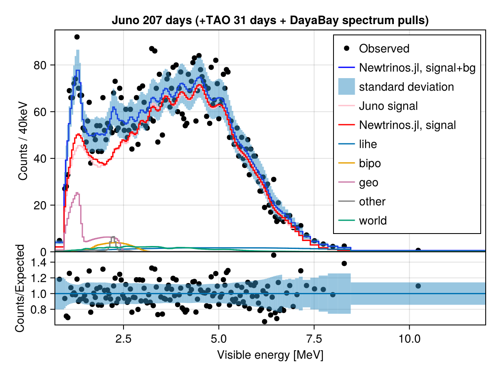
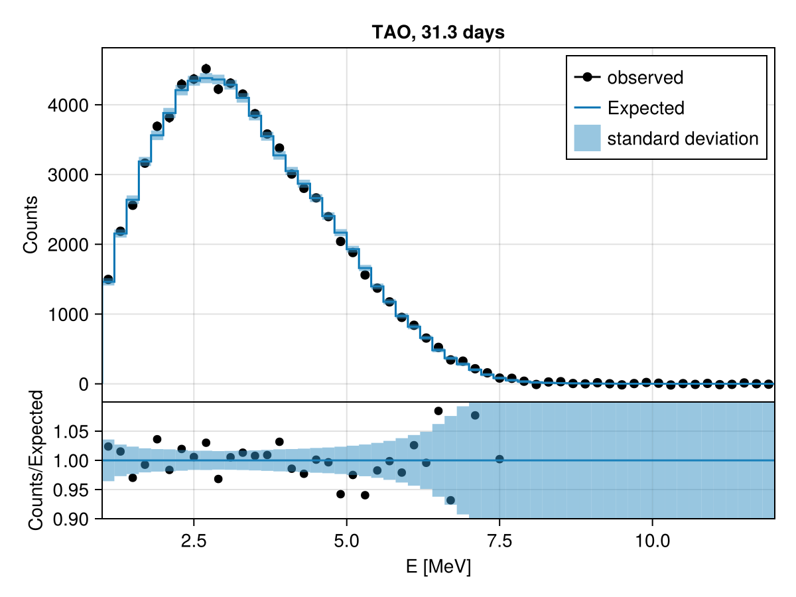
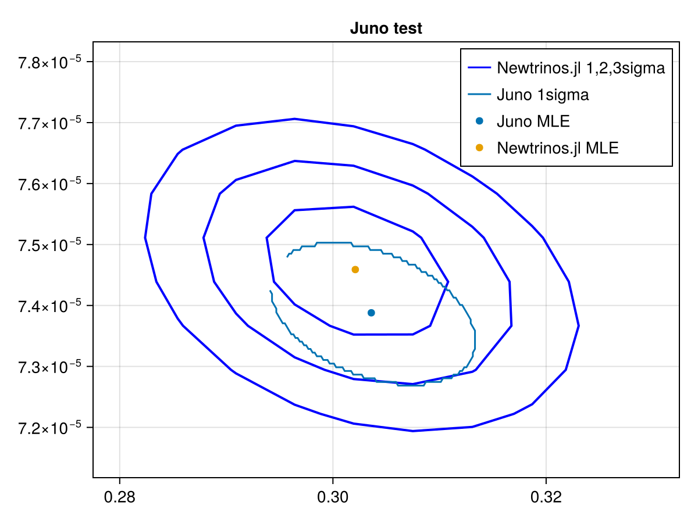
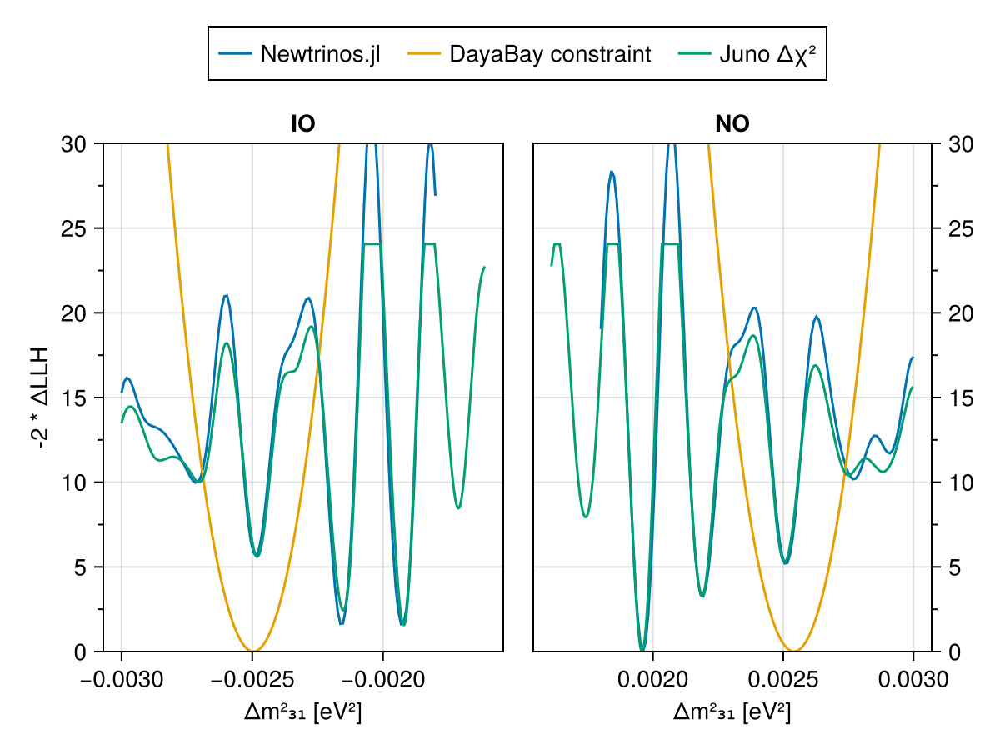

# JUNO
 ## Resources
Data source: https://arxiv.org/abs/2609.37895, https://arxiv.org/abs/2610.23331
Data extraction performed by claude
## Test output plots

## Meta Information
- **task**: profile
- **date**: 2026-11-10 15:21:17
- **vars_to_scan**: OrderedDict{Any, Any}(:θ₁₂ => 10, :Δm²₂₁ => 10)
- **username**: julian
- **repo_clean**: false
- **exec_time**: 1.749898910522461
- **repo**: /Users/julian/Projects/DEMOS/neutrinos/osc/Newtrinos.jl
- **hostname**: Julians-MacBook-Pro.local
- **params**: (energy_per_fission = [202.36517538109993, 205.99283476966744, 211.1249463835718, 214.26084586562925], juno_bipo_rate = 0.5801791095507063, juno_dayabay_ffs = [0.9998811552639181, 1.0000108442028663, 1.0001272142632838, 1.000087341188061], juno_dayabay_neq_scale = [1.001389033956888, 1.0, 1.0001904842046287, 1.0000464387637322], juno_dayabay_snf_scale = 1.001133405589464, juno_e_scale = 0.9986416729790542, juno_efficiency = 0.7372140276394741, juno_eres_unc_scale = 1.0042243408435583, juno_geo_rate = 1.7738768290026796, juno_lihe_rate = 1.3676806797294414, juno_lsnl_pull = -0.40477500878480566, juno_other_rate = 0.37943577418637087, juno_reactor_thermal_power_scale = [0.9921253380475279, 0.973283270981044, 0.9976445336623851, 0.9975840710783508, 0.9977030727677276, 0.9977195518521977, 0.9975003380140439, 0.9976247279110828, 1.0008418870473645], juno_taishan_ffs = [0.9975740671567358, 1.0000899059421928, 1.0027175383852325, 1.0012466486955711], juno_taishan_neq_scale = [0.9956645032688926, 1.0, 0.9992764079227713, 0.9998673623230975], juno_taishan_snf_scale = 0.9978374911165593, juno_world_reactor_rate = 0.9194710437274183, juno_yangjiang_ffs = [0.9921962916487844, 1.000278918440735, 1.0087158851971103, 1.0039921837177748], juno_yangjiang_neq_scale = [0.986396144887591, 1.0, 0.9976978979073542, 0.9995798161974935], juno_yangjiang_snf_scale = 0.9959665879505699, spectrum_pulls = [-0.09707129846524186, -0.026282925151889444, -0.11461577368091533, -0.050262822508199495, -0.11759619422141387, -0.06193046984585046, -0.08031070042608779, -0.08776659484790385, -0.055837426739504176, -0.06189207423998573, -0.06314121768666395, -0.06316178468819958, -0.05560210806958622, -0.006081212420145104, 0.023297105933060877, 0.02784083040159486, 0.06107353428134264, 0.042340009860685195, 0.02800478855274935, -0.07838761488211118, 0.06644687428870727, -0.13223135014581303, -0.031124793527375974, 0.018711096265371985, -0.4607459816060108], tao_e_scale = 0.9889890071189686, tao_efficiency = 0.414135821415097, tao_eres_pull = 0.2200985023071814, tao_lsnl_juno_pull = 0.3181623366044431, tao_lsnl_pull = 0.0649176936066944, tao_reactor_thermal_power_scale = 1.0, tao_taishan_ffs = [0.9642670048103327, 1.0011028073378947, 1.0392457454302133, 1.0183214381353596], Δm²₂₁ = 7.45891449420528e-5, Δm²₃₁ = 0.002513446464032619, δCP = 1.0, θ₁₂ = 0.5819282859471339, θ₁₃ = 0.14811583170456377, θ₂₃ = 0.8556288707523761)
- **starts**: [NamedTuple()]
- **package_version**: 0.1.1
- **cache_dir**: combined_scratch
- **priors**: (energy_per_fission = DiagNormal(
dim: 4
μ: [202.36, 205.99, 211.12, 214.26]
Σ: [0.06760000000000001 0.0 0.0 0.0; 0.0 0.27040000000000003 0.0 0.0; 0.0 0.0 0.11560000000000002 0.0; 0.0 0.0 0.0 0.10890000000000001]
)
, juno_bipo_rate = Truncated(Normal{Float64}(μ=0.42, σ=0.31); lower=0.0, upper=Inf), juno_dayabay_ffs = FullNormal(
dim: 4
μ: [1.0, 1.0, 1.0, 1.0]
Σ: [0.0025 -0.00055 -0.001325 -0.00045; -0.00055 0.0025 0.00045 0.0006500000000000001; -0.001325 0.00045 0.0025 0.001225; -0.00045 0.0006500000000000001 0.001225 0.0025]
)
, juno_dayabay_neq_scale = DiagNormal(
dim: 4
μ: [1.0, 1.0, 1.0, 1.0]
Σ: [0.09 0.0 0.0 0.0; 0.0 0.09 0.0 0.0; 0.0 0.0 0.09 0.0; 0.0 0.0 0.0 0.09]
)
, juno_dayabay_snf_scale = Normal{Float64}(μ=1.0, σ=0.3), juno_e_scale = Truncated(Normal{Float64}(μ=1.0, σ=0.005); lower=0.5, upper=1.5), juno_efficiency = Truncated(Normal{Float64}(μ=0.7401, σ=0.010361399999999998); lower=0.0, upper=Inf), juno_eres_unc_scale = Truncated(Normal{Float64}(μ=1.0, σ=0.05); lower=0.0, upper=Inf), juno_geo_rate = Uniform{Float64}(a=0.0, b=5.0), juno_lihe_rate = Truncated(Normal{Float64}(μ=1.05, σ=0.27); lower=0.0, upper=Inf), juno_lsnl_pull = Normal{Float64}(μ=0.0, σ=1.0), juno_other_rate = Truncated(Normal{Float64}(μ=0.33, σ=0.11); lower=0.0, upper=Inf), juno_reactor_thermal_power_scale = Truncated{Normal{Float64}, Continuous, Float64, Float64, Float64}[Truncated(Normal{Float64}(μ=1.0, σ=0.05); lower=0.1, upper=1.9), Truncated(Normal{Float64}(μ=1.0, σ=0.12); lower=0.1, upper=1.9), Truncated(Normal{Float64}(μ=1.0, σ=0.03); lower=0.1, upper=1.9), Truncated(Normal{Float64}(μ=1.0, σ=0.03); lower=0.1, upper=1.9), Truncated(Normal{Float64}(μ=1.0, σ=0.03); lower=0.1, upper=1.9), Truncated(Normal{Float64}(μ=1.0, σ=0.03); lower=0.1, upper=1.9), Truncated(Normal{Float64}(μ=1.0, σ=0.03); lower=0.1, upper=1.9), Truncated(Normal{Float64}(μ=1.0, σ=0.03); lower=0.1, upper=1.9), Truncated(Normal{Float64}(μ=1.0, σ=0.03); lower=0.1, upper=1.9)], juno_taishan_ffs = FullNormal(
dim: 4
μ: [1.0, 1.0, 1.0, 1.0]
Σ: [0.0025 -0.00055 -0.001325 -0.00045; -0.00055 0.0025 0.00045 0.0006500000000000001; -0.001325 0.00045 0.0025 0.001225; -0.00045 0.0006500000000000001 0.001225 0.0025]
)
, juno_taishan_neq_scale = DiagNormal(
dim: 4
μ: [1.0, 1.0, 1.0, 1.0]
Σ: [0.09 0.0 0.0 0.0; 0.0 0.09 0.0 0.0; 0.0 0.0 0.09 0.0; 0.0 0.0 0.0 0.09]
)
, juno_taishan_snf_scale = Normal{Float64}(μ=1.0, σ=0.3), juno_world_reactor_rate = Truncated(Normal{Float64}(μ=0.92, σ=0.09); lower=0.0, upper=Inf), juno_yangjiang_ffs = FullNormal(
dim: 4
μ: [1.0, 1.0, 1.0, 1.0]
Σ: [0.0025 -0.00055 -0.001325 -0.00045; -0.00055 0.0025 0.00045 0.0006500000000000001; -0.001325 0.00045 0.0025 0.001225; -0.00045 0.0006500000000000001 0.001225 0.0025]
)
, juno_yangjiang_neq_scale = DiagNormal(
dim: 4
μ: [1.0, 1.0, 1.0, 1.0]
Σ: [0.09 0.0 0.0 0.0; 0.0 0.09 0.0 0.0; 0.0 0.0 0.09 0.0; 0.0 0.0 0.0 0.09]
)
, juno_yangjiang_snf_scale = Normal{Float64}(μ=1.0, σ=0.3), spectrum_pulls = FullNormal(
dim: 25
μ: [-0.06577241280108859, -0.05473038409036679, -0.09598595671575638, -0.0630006333508153, -0.10841004998845283, -0.06917368589011874, -0.07457678210778729, -0.09357716150515116, -0.049096774340866234, -0.0699288263386133, -0.0536203005622129, -0.07474275863457025, -0.04444627641626697, -0.013566374876375464, 0.025722960907802683, 0.031235089050074327, 0.0549334279260385, 0.04898994575830318, 0.02861939535755198, -0.09019622785979042, 0.09068364134839424, -0.16454981859805518, -0.001824584200168733, 0.0069255574817408405, -0.4551915034910957]
Σ: [0.0010689483242489067 -0.0009163076151903775 0.0005721937248776966 -0.00038490582807146 0.0002744943762131843 -0.000203796684629132 0.00015514711907501413 -0.00012132058767492613 9.496786834791827e-5 -7.427285522604239e-5 5.8986861828524304e-5 -4.792968680190252e-5 3.861992023778361e-5 -3.1415013079705765e-5 2.607916954635482e-5 -2.1919824953333216e-5 1.865546886854665e-5 -1.627583603417919e-5 1.3791800308715068e-5 -1.165408742017525e-5 9.440737635327307e-6 -7.179716387718711e-6 4.176353767251559e-6 -1.1527660393497202e-6 5.498132259302651e-7; -0.0009163076151903775 0.0008274545142980929 -0.000522856228933632 0.00035229809181716766 -0.00025152287902236695 0.00018660953515890164 -0.0001422416278959134 0.00011108804367385825 -8.710535788022363e-5 6.79836407574558e-5 -5.410661676441374e-5 4.381677744099642e-5 -3.542140162427519e-5 2.872507904051004e-5 -2.400574921880341e-5 2.011099666891109e-5 -1.7244515243870243e-5 1.4983416865595329e-5 -1.2816662107914296e-5 1.0766716275706772e-5 -8.789950917982308e-6 6.642046994805506e-6 -3.937339843728532e-6 1.0548309363923213e-6 -5.381202581760364e-7; 0.0005721937248776966 -0.000522856228933632 0.0003537364921645064 -0.0002433873655094281 0.00017451580958155032 -0.0001296068888219117 9.879873112109445e-5 -7.717543432228294e-5 6.049441372869888e-5 -4.7218375110465585e-5 3.7550466254147336e-5 -3.0401149349820084e-5 2.4529901273128955e-5 -1.987142608523212e-5 1.6550899228011235e-5 -1.382889081019595e-5 1.1789868639079116e-5 -1.0218798857723544e-5 8.722827578473356e-6 -7.359229996230818e-6 6.0366936699160695e-6 -4.604768714307985e-6 2.7437074312141584e-6 -7.464007416534422e-7 3.772236161853041e-7; -0.00038490582807146 0.00035229809181716766 -0.0002433873655094281 0.0001863615625592508 -0.00013833579948290117 0.00010358080938722183 -7.913308099932856e-5 6.183363798268379e-5 -4.84914511298314e-5 3.783599314270681e-5 -3.010132378926989e-5 2.4348857749946453e-5 -1.965101665691453e-5 1.5897048165506865e-5 -1.3259731587342714e-5 1.1077666483176749e-5 -9.482956776995737e-6 8.238960746703522e-6 -7.076860125008343e-6 5.988919548446648e-6 -4.943131189918747e-6 3.771507526790756e-6 -2.255709498813045e-6 6.078854071827322e-7 -3.1174251067661194e-7; 0.0002744943762131843 -0.00025152287902236695 0.00017451580958155032 -0.00013833579948290117 0.00011903434405118245 -9.379355938946704e-5 7.262293114723279e-5 -5.6964184534183194e-5 4.470583747739834e-5 -3.490526323953122e-5 2.775788098208352e-5 -2.2461748077096238e-5 1.8110453348921067e-5 -1.4660969846612842e-5 1.2214612740673152e-5 -1.022228645797335e-5 8.741052933948587e-6 -7.605383679360477e-6 6.506584577319477e-6 -5.491046402016291e-6 4.493679007231267e-6 -3.4169151391651035e-6 2.0301922639972047e-6 -5.518318306560457e-7 2.789562759809438e-7; -0.000203796684629132 0.00018660953515890164 -0.0001296068888219117 0.00010358080938722183 -9.379355938946704e-5 8.92274798793917e-5 -7.401219891466796e-5 5.924265083405559e-5 -4.681386981149821e-5 3.662673747932966e-5 -2.9169638359800948e-5 2.360137931035424e-5 -1.9040022994964247e-5 1.5393569583601116e-5 -1.2830733561546694e-5 1.0715405050109403e-5 -9.15879285575799e-6 7.927643085226666e-6 -6.764115051855375e-6 5.676935048111978e-6 -4.6436203773718996e-6 3.514076961381222e-6 -2.08556856783322e-6 5.57354264002781e-7 -2.85208541766176e-7; 0.00015514711907501413 -0.0001422416278959134 9.879873112109445e-5 -7.913308099932856e-5 7.262293114723279e-5 -7.401219891466796e-5 7.692883995669597e-5 -6.711700518416977e-5 5.4593806222007595e-5 -4.3175496445762956e-5 3.451338214512759e-5 -2.7985695114791587e-5 2.258163781028898e-5 -1.8275688108230908e-5 1.5223723583934521e-5 -1.2732441691259549e-5 1.0880761995695816e-5 -9.452528790850908e-6 8.075896250958822e-6 -6.810431952597945e-6 5.578582176966214e-6 -4.246327748773077e-6 2.5222392755649515e-6 -6.832195367672122e-7 3.4535895423997103e-7; -0.00012132058767492613 0.00011108804367385825 -7.717543432228294e-5 6.183363798268379e-5 -5.6964184534183194e-5 5.924265083405559e-5 -6.711700518416977e-5 7.501654184742701e-5 -6.764340939025922e-5 5.5605093470585805e-5 -4.5163022704886664e-5 3.685819188316443e-5 -2.9857897955041038e-5 2.420951452421588e-5 -2.0219094481816726e-5 1.692333243000664e-5 -1.4494682754782309e-5 1.2582870716686956e-5 -1.0762798428654243e-5 9.052219069312355e-6 -7.40775048442525e-6 5.6080755340537986e-6 -3.3276026448294888e-6 8.921969671436707e-7 -4.56120547066737e-7; 9.496786834791827e-5 -8.710535788022363e-5 6.049441372869888e-5 -4.84914511298314e-5 4.470583747739834e-5 -4.681386981149821e-5 5.4593806222007595e-5 -6.764340939025922e-5 7.942256941608559e-5 -7.346615273629016e-5 6.264626824430204e-5 -5.226330725734936e-5 4.276987655511825e-5 -3.488095524304335e-5 2.9198461467091252e-5 -2.448508243454443e-5 2.0965401519447658e-5 -1.8212815049366927e-5 1.5550618725752014e-5 -1.3085123705856749e-5 1.0687607389120732e-5 -8.09323426401396e-6 4.784331445250336e-6 -1.287896081692044e-6 6.523660823091599e-7; -7.427285522604239e-5 6.79836407574558e-5 -4.7218375110465585e-5 3.783599314270681e-5 -3.490526323953122e-5 3.662673747932966e-5 -4.3175496445762956e-5 5.5605093470585805e-5 -7.346615273629016e-5 8.933477013622501e-5 -8.673624612738521e-5 7.666472265847696e-5 -6.453607390747063e-5 5.3381426739464975e-5 -4.505806794811054e-5 3.794781474096695e-5 -3.2607831066411274e-5 2.8374892379921778e-5 -2.4286393870728185e-5 2.0425948702368924e-5 -1.6682528307210164e-5 1.259629649712872e-5 -7.446176522133921e-6 1.9926956475145666e-6 -1.016137160239022e-6; 5.8986861828524304e-5 -5.410661676441374e-5 3.7550466254147336e-5 -3.010132378926989e-5 2.775788098208352e-5 -2.9169638359800948e-5 3.451338214512759e-5 -4.5163022704886664e-5 6.264626824430204e-5 -8.673624612738521e-5 0.00011056267272964822 -0.00011204347134206699 0.0001006971651180469 -8.613726794590489e-5 7.401387458032583e-5 -6.302210336796308e-5 5.4503922296367055e-5 -4.767075474777028e-5 4.0925825105398026e-5 -3.455156890906705e-5 2.8285836858283897e-5 -2.1440104608407556e-5 1.2695211258454492e-5 -3.417708367702409e-6 1.7345645678062648e-6; -4.792968680190252e-5 4.381677744099642e-5 -3.0401149349820084e-5 2.4348857749946453e-5 -2.2461748077096238e-5 2.360137931035424e-5 -2.7985695114791587e-5 3.685819188316443e-5 -5.226330725734936e-5 7.666472265847696e-5 -0.00011204347134206699 0.00014754268143093633 -0.00015256811361086635 0.00014005236664974593 -0.0001249591195782847 0.0001086412405234983 -9.513975721905447e-5 8.3820554154732e-5 -7.23177504063972e-5 6.120640391529207e-5 -5.0221090842760444e-5 3.808198859165267e-5 -2.2575613669184783e-5 6.06259061147012e-6 -3.088222600354106e-6; 3.861992023778361e-5 -3.542140162427519e-5 2.4529901273128955e-5 -1.965101665691453e-5 1.8110453348921067e-5 -1.9040022994964247e-5 2.258163781028898e-5 -2.9857897955041038e-5 4.276987655511825e-5 -6.453607390747063e-5 0.0001006971651180469 -0.00015256811361086635 0.000202153514669977 -0.00021337998111278406 0.00020484766276224507 -0.00018545210763852815 0.0001661195812474382 -0.0001483622385741333 0.0001290038712401685 -0.00010972145032350325 9.026432467649488e-5 -6.85919923619747e-5 4.0677317955260086e-5 -1.0949080275333543e-5 5.563409748748825e-6; -3.1415013079705765e-5 2.872507904051004e-5 -1.987142608523212e-5 1.5897048165506865e-5 -1.4660969846612842e-5 1.5393569583601116e-5 -1.8275688108230908e-5 2.420951452421588e-5 -3.488095524304335e-5 5.3381426739464975e-5 -8.613726794590489e-5 0.00014005236664974593 -0.00021337998111278406 0.00028363387420319533 -0.00031198972352345137 0.0003042591982960233 -0.0002840943964495292 0.0002599261533940649 -0.00022936170120161676 0.00019676666318934347 -0.00016275863667304863 0.00012405498907038553 -7.37406513167386e-5 1.9848319159390923e-5 -1.0105349311389044e-5; 2.607916954635482e-5 -2.400574921880341e-5 1.6550899228011235e-5 -1.3259731587342714e-5 1.2214612740673152e-5 -1.2830733561546694e-5 1.5223723583934521e-5 -2.0219094481816726e-5 2.9198461467091252e-5 -4.505806794811054e-5 7.401387458032583e-5 -0.0001249591195782847 0.00020484766276224507 -0.00031198972352345137 0.0004242377703518402 -0.0004716021242474571 0.0004735120091755403 -0.00045174814424099943 0.00040847956840828886 -0.00035554499152992035 0.00029659612321461645 -0.00022723500374961794 0.0001354448379710043 -3.655861879369535e-5 1.8596767804912033e-5; -2.1919824953333216e-5 2.011099666891109e-5 -1.382889081019595e-5 1.1077666483176749e-5 -1.022228645797335e-5 1.0715405050109403e-5 -1.2732441691259549e-5 1.692333243000664e-5 -2.448508243454443e-5 3.794781474096695e-5 -6.302210336796308e-5 0.0001086412405234983 -0.00018545210763852815 0.0003042591982960233 -0.0004716021242474571 0.0006374058671597954 -0.0007240067722292258 0.0007417778005834337 -0.0006990295455427501 0.0006231086764484607 -0.0005272486117055823 0.0004073520428261998 -0.0002440602373730127 6.604819368592758e-5 -3.364321406037644e-5; 1.865546886854665e-5 -1.7244515243870243e-5 1.1789868639079116e-5 -9.482956776995737e-6 8.741052933948587e-6 -9.15879285575799e-6 1.0880761995695816e-5 -1.4494682754782309e-5 2.0965401519447658e-5 -3.2607831066411274e-5 5.4503922296367055e-5 -9.513975721905447e-5 0.0001661195812474382 -0.0002840943964495292 0.0004735120091755403 -0.0007240067722292258 0.0009770285785496396 -0.0011229434488818275 0.001132684224863137 -0.0010503037528523378 0.0009096488551422204 -0.0007127328141785971 0.00043061277433651627 -0.000117204956782147 5.9716714303377124e-5; -1.627583603417919e-5 1.4983416865595329e-5 -1.0218798857723544e-5 8.238960746703522e-6 -7.605383679360477e-6 7.927643085226666e-6 -9.452528790850908e-6 1.2582870716686956e-5 -1.8212815049366927e-5 2.8374892379921778e-5 -4.767075474777028e-5 8.3820554154732e-5 -0.0001483622385741333 0.0002599261533940649 -0.00045174814424099943 0.0007417778005834337 -0.0011229434488818275 0.001512129721902969 -0.0017007747043448161 0.0016828081499264478 -0.0015145268193476706 0.0012139210145156265 -0.0007434493676774801 0.00020406669056875418 -0.00010416489369417033; 1.3791800308715068e-5 -1.2816662107914296e-5 8.722827578473356e-6 -7.076860125008343e-6 6.506584577319477e-6 -6.764115051855375e-6 8.075896250958822e-6 -1.0762798428654243e-5 1.5550618725752014e-5 -2.4286393870728185e-5 4.0925825105398026e-5 -7.23177504063972e-5 0.0001290038712401685 -0.00022936170120161676 0.00040847956840828886 -0.0006990295455427501 0.001132684224863137 -0.0017007747043448161 0.002215880526076036 -0.002429661003252648 0.002329050509107456 -0.0019385619221046805 0.001214078691529914 -0.00033805461062863404 0.00017289808877831356; -1.165408742017525e-5 1.0766716275706772e-5 -7.359229996230818e-6 5.988919548446648e-6 -5.491046402016291e-6 5.676935048111978e-6 -6.810431952597945e-6 9.052219069312355e-6 -1.3085123705856749e-5 2.0425948702368924e-5 -3.455156890906705e-5 6.120640391529207e-5 -0.00010972145032350325 0.00019676666318934347 -0.00035554499152992035 0.0006231086764484607 -0.0010503037528523378 0.0016828081499264478 -0.002429661003252648 0.003044527926952781 -0.003214702148851936 0.0028426106240194023 -0.0018465845203532133 0.0005262424482109793 -0.00027023389529947723; 9.440737635327307e-6 -8.789950917982308e-6 6.0366936699160695e-6 -4.943131189918747e-6 4.493679007231267e-6 -4.6436203773718996e-6 5.578582176966214e-6 -7.40775048442525e-6 1.0687607389120732e-5 -1.6682528307210164e-5 2.8285836858283897e-5 -5.0221090842760444e-5 9.026432467649488e-5 -0.00016275863667304863 0.00029659612321461645 -0.0005272486117055823 0.0009096488551422204 -0.0015145268193476706 0.002329050509107456 -0.003214702148851936 0.0038514103560924958 -0.003740040240517181 0.002578694471067288 -0.0007639997390601423 0.0003947621216587213; -7.179716387718711e-6 6.642046994805506e-6 -4.604768714307985e-6 3.771507526790756e-6 -3.4169151391651035e-6 3.514076961381222e-6 -4.246327748773077e-6 5.6080755340537986e-6 -8.09323426401396e-6 1.259629649712872e-5 -2.1440104608407556e-5 3.808198859165267e-5 -6.85919923619747e-5 0.00012405498907038553 -0.00022723500374961794 0.0004073520428261998 -0.0007127328141785971 0.0012139210145156265 -0.0019385619221046805 0.0028426106240194023 -0.003740040240517181 0.004124597216198834 -0.003132865882021164 0.0009921894269031765 -0.0005186238606243297; 4.176353767251559e-6 -3.937339843728532e-6 2.7437074312141584e-6 -2.255709498813045e-6 2.0301922639972047e-6 -2.08556856783322e-6 2.5222392755649515e-6 -3.3276026448294888e-6 4.784331445250336e-6 -7.446176522133921e-6 1.2695211258454492e-5 -2.2575613669184783e-5 4.0677317955260086e-5 -7.37406513167386e-5 0.0001354448379710043 -0.0002440602373730127 0.00043061277433651627 -0.0007434493676774801 0.001214078691529914 -0.0018465845203532133 0.002578694471067288 -0.003132865882021164 0.002759978817569943 -0.0009897938289603128 0.0005291955268973598; -1.1527660393497202e-6 1.0548309363923213e-6 -7.464007416534422e-7 6.078854071827322e-7 -5.518318306560457e-7 5.57354264002781e-7 -6.832195367672122e-7 8.921969671436707e-7 -1.287896081692044e-6 1.9926956475145666e-6 -3.417708367702409e-6 6.06259061147012e-6 -1.0949080275333543e-5 1.9848319159390923e-5 -3.655861879369535e-5 6.604819368592758e-5 -0.000117204956782147 0.00020406669056875418 -0.00033805461062863404 0.0005262424482109793 -0.0007639997390601423 0.0009921894269031765 -0.0009897938289603128 0.0004780980345912535 -0.0002739447210957238; 5.498132259302651e-7 -5.381202581760364e-7 3.772236161853041e-7 -3.1174251067661194e-7 2.789562759809438e-7 -2.85208541766176e-7 3.4535895423997103e-7 -4.56120547066737e-7 6.523660823091599e-7 -1.016137160239022e-6 1.7345645678062648e-6 -3.088222600354106e-6 5.563409748748825e-6 -1.0105349311389044e-5 1.8596767804912033e-5 -3.364321406037644e-5 5.9716714303377124e-5 -0.00010416489369417033 0.00017289808877831356 -0.00027023389529947723 0.0003947621216587213 -0.0005186238606243297 0.0005291955268973598 -0.0002739447210957238 0.00022841100902500745]
)
, tao_e_scale = Normal{Float64}(μ=1.0, σ=0.006), tao_efficiency = Normal{Float64}(μ=0.466, σ=0.05), tao_eres_pull = Normal{Float64}(μ=0.0, σ=1.0), tao_lsnl_juno_pull = Normal{Float64}(μ=0.0, σ=1.0), tao_lsnl_pull = Normal{Float64}(μ=0.0, σ=1.0), tao_reactor_thermal_power_scale = 1.0, tao_taishan_ffs = FullNormal(
dim: 4
μ: [1.0, 1.0, 1.0, 1.0]
Σ: [0.0025 -0.00055 -0.001325 -0.00045; -0.00055 0.0025 0.00045 0.0006500000000000001; -0.001325 0.00045 0.0025 0.001225; -0.00045 0.0006500000000000001 0.001225 0.0025]
)
, Δm²₂₁ = Uniform{Float64}(a=7.15e-5, b=7.8e-5), Δm²₃₁ = Normal{Float64}(μ=0.0025413, σ=6.0e-5), δCP = 1.0, θ₁₂ = Uniform{Float64}(a=0.5575988266995366, b=0.6119397146338674), θ₁₃ = Normal{Float64}(μ=0.14801178045127827, σ=0.002150302978800894), θ₂₃ = 0.8556288707523761)
- **commit_hash**: c4f3a32ce3e4a4bd190ed13cbcdc67c7e2739798
